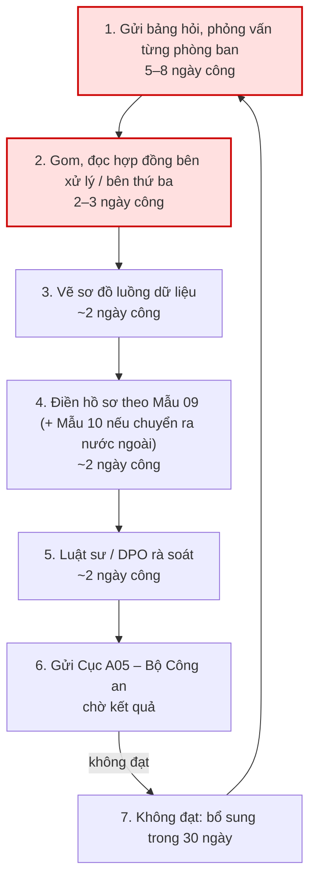
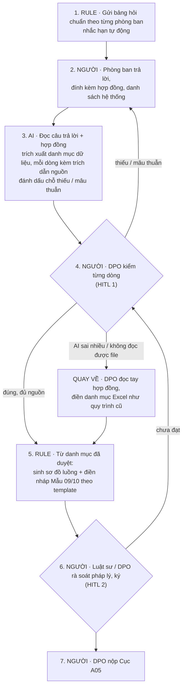

# Báo cáo nhóm — Day 02 Discovery & Problem Framing

> Bản chung của nhóm, viết trên repo do nhóm trưởng fork. Không copy file này sang repo cá nhân.
> Template chi tiết và prompt mẫu: [docs/01-worksheet.md](../../docs/01-worksheet.md). Bài mẫu: [docs/02-deliverable-example.md](../../docs/02-deliverable-example.md).

## 1. Thông tin nhóm

- Tên nhóm: 5npc
- Thành viên: xem `TEAM.md`
- Candidate problem được chọn (1 câu): Khi doanh nghiệp phải lập hồ sơ đánh giá tác động xử lý dữ liệu cá nhân theo luật mới, chuyên viên pháp chế/DPO mất 2–4 tuần chủ yếu để đi hỏi từng phòng ban đang thu thập dữ liệu gì, lưu ở đâu, chia sẻ cho ai, trong khi hồ sơ phải đạt ngay lần nộp đầu và cập nhật định kỳ.
- Quyết định cuối: Not Yet

---

## 2. Hội tụ nhóm (CP3)

### 2.1. Pitch

| # | Người đưa ra | Candidate (Job Story ngắn) | Actor | Bottleneck | Câu hỏi phản biện nhận được (ai hỏi) |
|---:|---|---|---|---|---|
| 1 | Hoàng Minh Quyền | Khi phải lập hồ sơ đánh giá tác động dữ liệu cá nhân theo luật mới, tôi muốn biết mọi phòng ban thu dữ liệu gì, lưu đâu, chia sẻ cho ai, để nộp đạt ngay lần đầu | Pháp chế / DPO doanh nghiệp lớn (bán lẻ, bảo hiểm, fintech, bệnh viện) | Hỏi và gom thông tin từ các phòng ban: 7–11 ngày công | Doanh nghiệp tự làm hay thuê trọn gói tư vấn? AI hiểu sai luật thì ai chịu? () |
| 2 | Hoàng Minh Quyền | Khi tới kỳ kiểm kê khí nhà kính / báo cáo CBAM, tôi muốn có đủ số liệu điện, nhiên liệu cả năm, để báo cáo đúng, không nộp lại | Cán bộ ESG nhà máy, DN xuất khẩu sang EU | Xin và nhập tay số liệu từ kế toán, kho, kỹ thuật: 2–4 tuần | FPT VertZéro và nền tảng khác đã làm chưa? () |
| 3 | Hoàng Minh Quyền | Khi nhận hồ sơ mời thầu mới, tôi muốn có ngay danh sách yêu cầu năng lực, giấy tờ kèm tài liệu mình đã có, để không bị loại vì thiếu hồ sơ | Chuyên viên đấu thầu công ty CNTT, thiết bị y tế, xây lắp | Đọc hồ sơ mời thầu + tìm tài liệu năng lực trong kho: 6–8 giờ/gói | Tỉ lệ bị loại vì thiếu hồ sơ có thật sự cao không? () |
| 4 | Ngô Minh Cương | Khi bàn giao ca trực, tôi muốn nắm nhanh sự cố chưa đóng, để ca sau không sót việc | Kỹ sư on-call, Incident Manager | Viết tóm tắt bàn giao: 10–15'/ca, hay sót thread Slack | Checklist bắt buộc đã đủ chưa? PagerDuty/incident.io có sẵn tính năng chưa? () |
| 5 | Ngô Minh Cương | Khi nhận bài nộp lab của 80 sinh viên, tôi muốn phát hiện ngay bài sai cấu trúc, thiếu file, link demo hỏng, để nhắc sửa trước hạn chấm | Trợ giảng (TA), giảng viên | Mở từng folder kiểm tra tay: 60–75'/80 bài | Script Python/Bash (Rule) đã giải được 90% chưa, cần gì AI? () |
| 6 | Ngô Minh Cương | Khi bị khách khiếu nại thiếu hàng trên sàn, tôi muốn tìm nhanh video đóng gói của đơn đó, để nộp bằng chứng trong 24h | Chủ shop, trưởng ca kho TMĐT | Tua camera tìm đúng lúc đóng đơn: 8–12'/đơn | Quét mã vạch + camera (Rule) đã giải được chưa? () |
| 7 | Đoàn Trí Hùng | Khi nhận task mới, tôi muốn hiểu rõ yêu cầu nghiệp vụ và phạm vi code cần sửa, để làm đúng ngay từ đầu | Developer dự án Nhật, leader | Đối chiếu BD/DD với source code: 10–20', gây hỏi lại leader | Tài liệu không được đưa ra AI ngoài, checklist đã đủ chưa? () |
| 8 | Đoàn Trí Hùng | Khi bắt đầu học một chủ đề ML mới, tôi muốn đi được từ toán, lý thuyết đến code ví dụ, để hiểu và áp dụng nhanh | Học viên mới học ML (chương trình AI VinUni) | Nối lý thuyết với code thực tế: 60–120'/chủ đề | Người học khác có cùng khó khăn không? Khó nhất ở chủ đề nào? () |
| 9 | Đoàn Trí Hùng | Khi gặp lỗi trong ứng dụng Intra-mart, tôi muốn nhanh chóng xác định nguyên nhân và hướng xử lý, để không mất quá nhiều thời gian debug | Developer Java/Intra-mart mới làm quen framework | Đọc source framework/dự án tìm module lỗi: 30–60'/lỗi | Ngoài hệ sinh thái Intra-mart có ai gặp không? Đã đo thời gian debug thật chưa? () |
| 10 | Dư Văn Hùng | Mỗi tuần, tôi muốn biết game nào trong portfolio bị review xấu tăng đột biến và vì sao, để xử lý trước khi rating tụt | Team ASO; Product/LiveOps nhận kết quả (nhà phát hành 100+ game) | Đọc, dịch, phân loại review đa ngôn ngữ: 15–20'/game/tuần | AppFollow, AppTweak đã giải chưa? () |
| 11 | Dư Văn Hùng | Khi nhận bug report từ người chơi, tôi muốn có đủ bước tái hiện, để dev sửa mà không phải hỏi lại | QA / dev team game indie | Hỏi lại và chờ trả lời: ~10' + chờ vài giờ đến 1 ngày/bug | Form/template bắt buộc có đủ không, cần gì AI? () |
| 12 | Dư Văn Hùng | Khi người chơi hỏi trên Discord, tôi muốn trả lời nhanh các câu lặp lại, để mod không trả lời mãi một câu | Mod Discord (tình nguyện viên), người chơi mới | Chờ mod thấy tin: 30'–vài giờ khi mod offline | Discord AutoMod / bot FAQ có sẵn đã giải chưa? () |
| 13 | Trần Quang Hà | Khi tự luyện IELTS Speaking/Writing, tôi muốn nhận ra lỗi diễn đạt lặp lại, để sửa dứt điểm trước khi thi | Người ôn thi IELTS | Tự tra và rà lỗi: 2–3 giờ/lần | ChatGPT / app chấm IELTS có sẵn đã đủ chưa? Ai trả tiền? () |
| 14 | Trần Quang Hà | Khi chuẩn bị bài dạy tiếng Anh cuối tuần cho 2 em nhỏ, tôi muốn có sẵn khung từ vựng và câu hỏi game, để không mất công soạn lại mà các bé không chán | Gia sư, học sinh lớp 2–3 | Tự soạn game trên Baamboozle: 1–2 giờ/tuần | Có kho game/bộ đề mẫu sẵn chưa? Actor chỉ 1 người thì impact bao nhiêu? () |
| 15 | Trần Quang Hà | Khi nghiên cứu công nghệ backend mới (Kafka KRaft, Microservices), tôi muốn nắm ngay kiến trúc cốt lõi, để bắt tay vào code thay vì chìm trong tài liệu dài | Backend developer | Đọc tài liệu, sách: 2–3 giờ/công nghệ, có lần 3 ngày | Khác gì đọc quick-start / hỏi ChatGPT? Đo "đã nắm kiến trúc" bằng gì? () |


### 2.2. Cluster

| Cluster | Các candidate | Pattern chung |
|---|---|---|
| A. Hồ sơ tuân thủ / thủ tục bắt buộc | #1 Hồ sơ dữ liệu cá nhân, #2 Kiểm kê khí nhà kính / CBAM, #3 Hồ sơ dự thầu | Quy định hoặc bên mời thầu ép phải nộp đủ; sai thì bị phạt, nộp lại hoặc bị loại. Nghẽn ở bước đi gom thông tin/tài liệu từ nhiều phòng ban |
| B. Tổng hợp thông tin rải rác để chuyển giao | #4 Bàn giao ca trực, #7 Phân tích yêu cầu nghiệp vụ, #10 ReviewRadar, #11 Bug report thiếu bước tái hiện | Thông tin nằm ở nhiều nguồn (Slack, Jira, tài liệu, review, tin nhắn người chơi); người làm phải đọc, tóm tắt hoặc hỏi lại cho người sau |
| C. Dò tìm bằng chứng / lỗi trong khối dữ liệu lớn | #5 Kiểm tra bài nộp lab, #6 Video đóng gói TMĐT, #9 Debug Intra-mart | Phải dò tay trong nhiều dữ liệu (folder bài nộp, video, log + source code) để tìm đúng chỗ sai |
| D. Học / truyền đạt kiến thức lặp lại | #8 Học ML, #12 Câu hỏi lặp trên Discord, #13 Lỗi luyện IELTS, #14 Soạn bài dạy tiếng Anh, #15 Nghiên cứu công nghệ backend | Actor chủ yếu là cá nhân; pain là thời gian tự tra cứu, soạn hoặc trả lời lại cùng một kiến thức |

### 2.3. Opportunity Solution Tree rút gọn

Gốc là **1 outcome**. Nhánh là **opportunity** (nhu cầu, pain), không phải tính năng hay công cụ.

```text
OUTCOME: Giảm thời gian lập hồ sơ đánh giá tác động xử lý dữ liệu cá nhân lần đầu
         từ 2–4 tuần công xuống dưới 1 tuần, và hồ sơ đạt ngay lần nộp đầu
├── Opportunity A: Thông tin dữ liệu nằm rải rác ở nhiều phòng ban; DPO phải đi hỏi từng nơi,
│                  chờ trả lời và hỏi lại nhiều vòng (bước 1, ~5–8 ngày công)
│   └── Phòng ban không biết mình đang "xử lý dữ liệu cá nhân" gì, trả lời bảng hỏi thiếu hoặc
│       sai thuật ngữ pháp lý
├── Opportunity B: Không biết bên thứ ba nào đang nhận dữ liệu; hợp đồng với bên xử lý nằm ở nhiều
│                  nơi, phải đọc từng hợp đồng để tìm điều khoản chia sẻ (bước 2, ~2–3 ngày công)
└── Opportunity C: Không chắc hồ sơ đã đủ và đúng Mẫu 09/10 trước khi nộp; sợ bị đánh giá
                   "không đạt" rồi phải bổ sung trong 30 ngày
    └── Mỗi 6 tháng hoặc khi có mục đích xử lý mới lại phải gom lại từ đầu vì không biết
        cái gì đã thay đổi
     ✗ "Chatbot hỏi đáp Luật 91/2025"            ← solution, gạch khỏi tầng này
     ✗ "AI đọc hợp đồng, tự soạn danh mục dữ liệu" ← solution, gạch khỏi tầng này
     ✗ "Phần mềm data mapping (OneTrust, …)"     ← tên công cụ, gạch khỏi tầng này
     ✗ "Bộ template + checklist Mẫu 09"          ← solution (dù không dùng AI), gạch khỏi tầng này
```

Những ý đã gạch bỏ vì là solution đội lốt opportunity:

- "Chatbot hỏi đáp Luật 91/2025": là công cụ; nhu cầu thật phía sau là "phòng ban không hiểu mình xử lý dữ liệu gì" → đã gộp vào nhánh con của Opportunity A.
- "AI đọc hợp đồng, tự soạn danh mục dữ liệu": là giả thuyết giải pháp cho Opportunity B, để dành cho CP6 (mức can thiệp AI).
- "Phần mềm data mapping kiểu OneTrust": là tên công cụ; đưa sang mục 3.3 Research giải pháp đã có.
- "Bộ template + checklist theo Mẫu 09/10": là phương án No AI cho Opportunity C, đưa sang bảng so sánh 4 mức ở 6.2.

### 2.4. Chấm điểm shortlist (1–5)

| Candidate | Actor rõ | Quy trình rõ | Pain có bằng chứng | Impact đo được | Vừa sức lab | So sánh được No AI/Rule/Workflow/Agent | Nhóm hiểu domain | Tổng |
|---|---:|---:|---:|---:|---:|---:|---:|---:|
| #1 Hồ sơ đánh giá tác động dữ liệu cá nhân | 5 | 5 | 3 | 5 | 3 | 5 | 2 | **28** |
| #10 ReviewRadar (review xấu tăng đột biến) | 4 | 4 | 3 | 3 | 5 | 3 | 4 | 26 |
| #2 Kiểm kê khí nhà kính / CBAM | 4 | 4 | 4 | 4 | 3 | 4 | 2 | 25 |

**Candidate được chọn:** #1, hồ sơ đánh giá tác động xử lý dữ liệu cá nhân.

**Vì sao chọn:** Tổng điểm cao nhất. Nghĩa vụ mới có hiệu lực từ 1/1/2026, chuyển sang tiền kiểm (đạt/không đạt), phải cập nhật 6 tháng/lần, nên nhu cầu bắt buộc và lặp lại. Quy trình theo mẫu cố định nên dễ chỉ ra bottleneck (bước 1–2: gom thông tin từ phòng ban, đọc hợp đồng bên thứ ba). Chọn kèm rủi ro đã biết: pain chưa có số đo và nhóm yếu domain. Hai điểm này chuyển thành giả định ưu tiên kiểm chứng ở CP4.

**Vì sao loại các candidate còn lại:**

- #10: điểm khá nhưng công cụ thương mại đã giải phần lớn; nếu làm dễ thành "làm lại AppFollow". Ghi vào hướng tiếp theo.
- #2: pain thật nhưng không lấy được dữ liệu mẫu trong lab, và đã có nền tảng trong nước làm.
- #3: cùng cluster A với #1 nhưng chưa có bằng chứng tỉ lệ bị loại vì thiếu hồ sơ.
- #4, #7, #11: #4 trùng tính năng PagerDuty/incident.io; #7 vướng quy định không đưa tài liệu khách hàng Nhật ra AI ngoài; #11 form/template bắt buộc có thể đã đủ.

**Xử lý bất đồng (nếu có):**

---

## 3. Kiểm chứng + research giải pháp đã có (CP4)

### 3.1. Assumption Map

| # | Giả định | Loại (Value / Usability / Feasibility / Viability) | Quan trọng (1–5) | Đã có bằng chứng (1–5) | Kiểm chứng trước? |
|---:|---|---|---:|---:|---|
| 1 | Lập hồ sơ lần đầu mất từ 2 tuần công trở lên, và phần lớn thời gian nằm ở bước gom thông tin từ phòng ban và hợp đồng bên thứ ba | Value | 5 | 2 | **Có** |
| 2 | Doanh nghiệp tự làm, hoặc ít nhất tự gom thông tin nội bộ, chứ không giao trọn gói cho công ty tư vấn | Viability | 5 | 1 | **Có** |
| 3 | Hồ sơ phải cập nhật định kỳ, nên đây là việc lặp lại chứ không phải làm một lần rồi thôi | Value | 4 | 3 (Nghị định 356) | **Có** |
| 4 | Công cụ đang dùng chủ yếu là Excel/Word và bảng hỏi gửi phòng ban; chưa có phần mềm làm theo mẫu Việt Nam | Value | 4 | 2 | **Có** |
| 5 | Có thể lấy được nguồn đầu vào (hợp đồng, chính sách quyền riêng tư, danh sách hệ thống) để thử trong lab mà không lộ dữ liệu thật | Feasibility | 4 | 1 |  |
| 6 | DPO/luật sư chấp nhận rà soát bản nháp do máy soạn thay vì tự viết từ đầu | Usability | 4 | 1 | |

Giả định nhóm kiểm chứng trong buổi này: **#1, #2, #3, #4**, bằng micro survey.

### 3.2. Kiểm chứng

Cách đã dùng: **Survey** (Google Form, 10 câu, ẩn danh), **14 người trả lời**. Ảnh chụp kết quả: [report/assets/](../assets/).

Hồ sơ người trả lời:

- Vai trò: DPO/Compliance 6/14, IT/An toàn thông tin 6/14, Nhân sự 2/14.
- Lĩnh vực: Công nghệ/Phần mềm 7/14, Ngân hàng/Tài chính/Fintech 6/14, Vận tải 1/14.
- Quy mô: dưới 50 người 1/14, 50–200 người 8/14, 200–1.000 người 5/14, trên 1.000 người 0/14.
- Đã lập hồ sơ chưa: đã làm xong 6/14, đang làm 5/14, chưa làm 3/14.

Interview snapshot (mỗi buổi phỏng vấn một bảng, hoặc đặt file trong report/assets/cp4-interview-snapshot-N.md):

Tổng hợp:

| Nguồn | Số người / số mẫu | Tín hiệu xác nhận | Tín hiệu phản bác |
|---|---:|---|---|
| Survey: thời gian | 14 | 9/14 mất từ 2 tuần trở lên: 2–4 tuần 3/14, **trên 1 tháng 6/14**. Không ai làm xong dưới 1 tuần (0/14) | **4/14 chỉ mất 1–2 tuần**, ít hơn mức 2–4 tuần nhóm giả định; 1/14 không rõ. Một số người đang làm hoặc chưa làm nên con số có thể là ước tính |
| Survey: bước tốn thời gian nhất (chọn tối đa 2) | 14 | Hỏi phòng ban 10/14 và gom hợp đồng bên thứ ba 10/14, **ngang nhau và cao nhất**; khớp bottleneck bước 1–2. Vẽ sơ đồ luồng 8/14 | Điền mẫu 6/14 và luật sư/DPO rà soát 6/14, nên bottleneck không chỉ nằm ở khâu gom; sửa/bổ sung sau khi bị yêu cầu 4/14 |
| Survey: ai làm | 14 | Tự làm nội bộ 5/14, nội bộ gom rồi tư vấn rà soát 3/14 → **8/14 vẫn phải tự gom thông tin** (8/11 người đã từng làm) | **3/14 thuê tư vấn làm trọn gói**, với nhóm này phần mềm cho DPO không có chỗ đứng; 3/14 chưa làm lần nào |
| Survey: công cụ (chọn nhiều) | 14 | Google Form/bảng hỏi 10/14, Excel/Word 7/14: làm thủ công là chủ yếu | **6/14 nói đã dùng "phần mềm chuyên dụng"** nhưng không ghi tên, cần hỏi lại; 3/14 để công ty tư vấn làm hết |
| Survey: cập nhật | 14 | 11/14 có cập nhật (định kỳ 9/14, khi có thay đổi 2/14) → việc lặp lại, khớp Nghị định 356 | 1/14 chưa cập nhật lần nào, 2/14 không rõ |
| Survey: mức khó (1–5) | 14 | 10/14 chấm 4–5 (9 người chấm 4, 1 người chấm 5); không ai chấm 1–2 | **4/14 chỉ chấm 3**; chỉ 1 người chấm 5, khó nhưng chưa phải "cực kỳ đau" |

Kết luận cho từng giả định:

| Giả định | Kết quả |
|---|---|
| #1 Thời gian + bottleneck | **Xác nhận một phần.** Bottleneck đúng ở khâu gom thông tin (hỏi phòng ban và hợp đồng bên thứ ba cùng 10/14), nhưng thời gian dao động lớn (1–2 tuần đến trên 1 tháng) và khâu rà soát cũng tốn thời gian (6/14) |
| #2 Tự làm hay thuê | **Xác nhận một phần.** 8/14 (8/11 người đã từng làm) vẫn tự gom thông tin, 3/14 thuê trọn gói |
| #3 Lặp lại | **Xác nhận** (11/14 có cập nhật, trong đó 9/14 cập nhật định kỳ) |
| #4 Công cụ thủ công | **Xác nhận một phần.** Google Form/Excel vẫn chiếm đa số, nhưng 6/14 đã dùng "phần mềm chuyên dụng", nên chưa thể kết luận "chưa có phần mềm" |

**Nhóm đã sửa problem thế nào sau kiểm chứng:**

- **Thu hẹp actor:** từ "DPO doanh nghiệp lớn" thành "DPO/IT ở doanh nghiệp **tự gom thông tin nội bộ**, gồm cả khi có tư vấn rà soát", chủ yếu là công ty công nghệ và fintech (13/14 người trả lời) quy mô 50–1.000 người (13/14). Loại nhóm thuê tư vấn trọn gói khỏi phạm vi.
- **Sửa baseline:** từ "2–4 tuần" thành "**1–2 tuần đến trên 1 tháng**, trung vị rơi vào nhóm **2–4 tuần**" (13 người có câu trả lời: 4 người 1–2 tuần, 3 người 2–4 tuần, 6 người trên 1 tháng). Target vẫn là dưới 1 tuần, mức mà hiện chưa ai trong survey đạt được.
- **Mở rộng bottleneck:** bước hỏi phòng ban và bước gom hợp đồng bên thứ ba ngang nhau (cùng 10/14). Hai bước này gộp thành một bottleneck: "biết dữ liệu đi đâu". Vẽ sơ đồ luồng (8/14) là bước tốn thời gian kế tiếp.
- **Ghi rủi ro:** khâu luật sư/DPO rà soát cũng tốn thời gian (6/14). Nếu bản nháp kém, thời gian rà soát có thể tăng chứ không giảm.
- **Việc tiếp theo:** phỏng vấn 1–2 trong 6 người đã chọn "phần mềm chuyên dụng" để biết đó là công cụ gì, giải được bước nào.

### 3.3. Research giải pháp đã có

| Công cụ / case / pattern | Link | Giải bước nào trong quy trình? | Điểm mạnh | Khoảng trống / rủi ro | Bài học cho nhóm |
|---|---|---|---|---|---|
| OneTrust: Data Mapping Automation + module PIA/DPIA | https://www.onetrust.com/news/iapp-data-mapping-automation/ | Bước 1–3: bảng hỏi gửi phòng ban, kiểm kê hệ thống và luồng dữ liệu, sơ đồ luồng; có module DPIA riêng | Nền tảng lớn nhất ngành, có tự động phát hiện và phân loại dữ liệu trên hệ thống | Chưa thấy nguồn chính thức xác nhận hỗ trợ mẫu hồ sơ theo Nghị định 356; giá doanh nghiệp, nặng với công ty 50–200 người | Pattern "bảng hỏi chuẩn gửi từng phòng ban → kiểm kê → sơ đồ luồng" đã là chuẩn; nhóm không cần phát minh lại, khoảng trống là **mẫu Việt Nam + giá vừa sức SME** |
| AesirX Compliance One: quy trình DPIA cho Luật 91/2025 | https://aesirx.io/blog/aesirx/the-dpia-triage-pipeline-from-trigger-to-dossier-without-a-separate-documentation-project | Từ phân loại khi nào cần DPIA đến hồ sơ; data mapping | Có nói rõ khung pháp lý Việt Nam (Luật 91/2025, Nghị định 356) | Nội dung marketing của nhà cung cấp, nhóm chưa kiểm được trích dẫn điều luật; chưa rõ có điền đúng mẫu hồ sơ không | Đã có đối thủ nhắm đúng thị trường Việt Nam → cần kiểm tra kỹ trước khi kết luận "chưa có phần mềm" |
| Dịch vụ tư vấn trong nước (Luật Việt An, CyStack, DPO.VN…) | https://luatvietan.vn/tu-van-danh-gia-tac-dong-xu-ly-du-lieu-ca-nhan.html · https://cystack.net/solutions/giai-phap-tuan-thu-nghi-dinh-13-cho-doanh-nghiep/pricing | Bước 4–5: điền mẫu, rà soát pháp lý; có nơi làm trọn gói | Chịu trách nhiệm pháp lý, đúng thứ 3/14 người trong survey chọn (thuê trọn gói) | Doanh nghiệp vẫn phải tự cung cấp thông tin nội bộ; không công bố giá; phải trả phí lại mỗi lần cập nhật | Đối thủ thật là **thuê tư vấn**, không phải phần mềm. Giải pháp nên giúp khâu gom nội bộ và xuất ra bộ hồ sơ để tư vấn rà soát nhanh hơn, không thay luật sư |


---

## 4. Quy trình trước/sau (CP5)

### 4.1. Quy trình hiện tại

Phạm vi: doanh nghiệp **tự gom thông tin nội bộ** (kể cả khi có tư vấn rà soát), theo actor đã thu hẹp sau CP4. Tổng thời gian lấy từ survey; thời gian từng bước là **giả định R&D** từ Problem Card, survey mới cho biết thứ tự bước tốn thời gian chứ chưa đo từng bước.

**Minh chứng (survey Google Form, 14 người trả lời, ảnh chụp trong `report/assets/`):** câu 4–6 (đã làm chưa, ai làm, tổng thời gian): [image-1.png](../assets/image-1.png); câu 7–8 (bước tốn thời gian nhất, công cụ): [image-2.png](../assets/image-2.png); câu 9–10 (cập nhật, mức khó): [image-3.png](../assets/image-3.png); hồ sơ người trả lời: [image.png](../assets/image.png).



| Bước | Actor | Input | Output | Thời gian / tần suất | Ghi chú |
|---:|---|---|---|---|---|
| 1 | DPO/IT gửi; trưởng hoặc nhân viên từng phòng ban trả lời | Bảng hỏi (Google Form/Excel), danh sách phòng ban | Câu trả lời của từng phòng: thu dữ liệu gì, mục đích, lưu ở đâu, chia sẻ cho ai | 5–8 ngày công (giả định) · mỗi lần lập/cập nhật hồ sơ | **Bottleneck.** Survey câu 7: 10/14 chọn, cao nhất (ngang bước 2). Phải hỏi lại nhiều vòng vì phòng ban trả lời thiếu hoặc sai thuật ngữ |
| 2 | DPO/pháp chế | Hợp đồng với bên xử lý, bên thứ ba (rải rác ở mua hàng, IT, kinh doanh) | Danh sách bên nhận dữ liệu, loại dữ liệu chia sẻ, có chuyển ra nước ngoài không | 2–3 ngày công (giả định) | **Bottleneck.** Survey câu 7: 10/14 chọn, cao nhất (ngang bước 1) |
| 3 | DPO/IT | Output bước 1–2 | Sơ đồ luồng dữ liệu (thu → lưu → chia sẻ → xóa) | ~2 ngày công (giả định) | Vẽ tay bằng Excel/Visio/draw.io. Survey câu 7: 8/14 chọn, tốn thời gian thứ ba |
| 4 | DPO/pháp chế | Output bước 1–3 | Bản nháp hồ sơ theo Mẫu 09 (Mẫu 10 nếu chuyển dữ liệu ra nước ngoài) | ~2 ngày công (giả định) | Survey câu 7: 6/14 chọn là tốn thời gian; câu 8: 7/14 làm bằng Excel/Word |
| 5 | Luật sư nội bộ/DPO, hoặc tư vấn bên ngoài | Bản nháp hồ sơ | Hồ sơ đã rà soát, ký | ~2 ngày công (giả định) | Survey câu 7: 6/14 cũng chọn bước này là tốn thời gian |
| 6 | DPO | Hồ sơ đã ký | Hồ sơ nộp Cục A05 | Thời gian chờ kết quả không tính vào ngày công | Nghĩa vụ từ 1/1/2026 |
| 7 | DPO + phòng ban liên quan | Yêu cầu bổ sung từ A05 | Hồ sơ bổ sung | Trong 30 ngày | Nếu thiếu thông tin luồng dữ liệu thì phải quay lại bước 1. Survey câu 7: 4/14 chọn bước sửa/bổ sung là tốn thời gian |

**Tổng (survey câu 6, 13/14 người có câu trả lời):** từ 1–2 tuần đến trên 1 tháng, trung vị rơi vào nhóm **2–4 tuần**: dưới 1 tuần 0/14, 1–2 tuần 4/14, 2–4 tuần 3/14, trên 1 tháng 6/14, không rõ 1/14. Câu 4 cho thấy chỉ 6/14 đã làm xong (5/14 đang làm, 3/14 chưa làm), nên một phần con số là ước tính. **Tần suất (câu 9):** lần đầu, sau đó cập nhật: 11/14 có cập nhật (9/14 định kỳ, 2/14 khi có thay đổi).

**Bottleneck chính:** bước 1–2 gộp lại, tức là **"biết dữ liệu cá nhân đang đi đâu"**: hỏi từng phòng ban và đọc từng hợp đồng bên thứ ba để biết dữ liệu nào được thu, lưu ở đâu, chia sẻ cho ai. Hai bước này chiếm 7–11/13–17 ngày công giả định, và là hai bước được survey chọn nhiều nhất (câu 7: cùng 10/14).

### 4.2. Quy trình tương lai

Nguyên tắc rút từ research (3.3): **không thay luật sư/tư vấn**, chỉ rút ngắn khâu gom thông tin nội bộ và xuất ra bộ dữ liệu đủ để người rà soát làm nhanh hơn. Mức can thiệp cuối cùng chốt ở mục 6; dưới đây là thiết kế đang đề xuất.



| Bước | Ai làm | Việc | Boundary / kiểm tra |
|---:|---|---|---|
| 1 | **Rule** | Bảng hỏi chuẩn theo trường thông tin của Mẫu 09/10, gửi tự động cho từng phòng ban, nhắc hạn | Câu hỏi cố định, không do AI sinh |
| 2 | **Con người** | Phòng ban trả lời, đính kèm hợp đồng bên xử lý/bên thứ ba, danh sách hệ thống | AI không thay phòng ban khai báo |
| 3 | **AI** | Đọc câu trả lời + hợp đồng, trích ra bảng danh mục: loại dữ liệu, mục đích, nơi lưu, bên nhận, có chuyển ra nước ngoài không. **Mỗi dòng phải kèm trích dẫn đoạn nguồn**; chỗ nào thiếu hoặc mâu thuẫn thì đánh dấu thành câu hỏi bổ sung | Không tự điền trường không có nguồn; chạy trên mô hình được công ty phê duyệt, không đưa hợp đồng ra công cụ AI công cộng |
| 4 | **Con người (HITL 1)** | DPO kiểm từng dòng đối chiếu với trích dẫn, duyệt hoặc sửa; gửi câu hỏi bổ sung về phòng ban | Mọi dòng phải được DPO duyệt mới sang bước 5 |
| 5 | **Rule** | Từ danh mục đã duyệt, sinh sơ đồ luồng và điền nháp mẫu hồ sơ theo template cố định | Ánh xạ cố định từ bảng sang mẫu, không có AI |
| 6 | **Con người (HITL 2)** | Luật sư/DPO rà soát pháp lý, quyết định nội dung cuối, ký | Kết luận pháp lý chỉ do con người đưa ra |
| 7 | **Con người** | DPO nộp hồ sơ cho Cục A05 | AI không được nộp |

**Boundary — AI không được:**

- Nộp hồ sơ, gửi thông tin cho cơ quan nhà nước hay bên ngoài.
- Kết luận việc xử lý dữ liệu có hợp pháp không, hay đánh giá mức rủi ro pháp lý.
- Điền bất kỳ trường nào không có trích dẫn từ tài liệu nguồn.
- Gửi hợp đồng, câu trả lời của phòng ban ra công cụ AI không được công ty phê duyệt.

**Khi nào con người kiểm tra (HITL):** DPO duyệt **mọi dòng** danh mục do AI trích (bước 4) trước khi sinh hồ sơ; luật sư/DPO rà soát và ký toàn bộ hồ sơ (bước 6) trước khi nộp.

**Phương án quay về:** bảng danh mục vẫn là file Excel cùng cấu trúc với cách làm cũ. Nếu ở bước 4 DPO thấy AI trích sai nhiều, hoặc AI không đọc được tài liệu (bản scan, ảnh chụp), DPO bỏ kết quả AI, đọc tay hợp đồng và điền tiếp vào cùng bảng như quy trình hiện tại. Bước 1, 5 là Rule nên vẫn dùng được khi tắt AI.

### 4.3. Before / after

| Chỉ số | Trước | Sau (kỳ vọng) | Ghi chú |
|---|---:|---:|---|
| Số bước | 7 | 7 | Không bớt bước; đổi người làm ở bước 1, 3, 5 |
| Tổng thời gian | 1–2 tuần đến trên 1 tháng, trung vị nhóm 2–4 tuần | Dưới 1 tuần | "Trước" lấy từ survey câu 6 ([image-1.png](../assets/image-1.png)); "sau" là target, **chưa kiểm chứng** (hiện 0/14 đạt), cần đo khi pilot |
| Số bước thủ công | 7/7 | 4/7 (bước 2, 4, 6, 7) | 2 bước Rule (1, 5), 1 bước AI (3) |
| Bottleneck chính | Bước 1–2: hỏi phòng ban + đọc hợp đồng bên thứ ba | Dự kiến chuyển sang bước 2 (chờ phòng ban trả lời) và bước 4 (DPO kiểm danh mục) | AI không rút ngắn được thời gian **chờ người**; Rule nhắc hạn chỉ giảm một phần |
| Rủi ro mới phát sinh | — | (1) AI bỏ sót bên nhận dữ liệu → hồ sơ thiếu mà không ai biết; (2) DPO tin bản nháp, duyệt qua loa; (3) đưa hợp đồng nhạy cảm vào AI; (4) bản nháp kém làm bước rà soát lâu hơn (survey câu 7: 6/14 đã thấy rà soát tốn thời gian) | (1) xử lý bằng bảng hỏi Rule ở bước 1 làm nguồn đối chiếu; (2) bằng trích dẫn bắt buộc từng dòng; (3) bằng boundary về công cụ được phê duyệt; (4) bằng ngưỡng quay về |

---

## 5. Problem Statement v0 (CP5)

| Trường | Nội dung |
|---|---|
| **Actor** | DPO hoặc nhân sự IT/pháp chế kiêm nhiệm ở **doanh nghiệp 50–200 người** (chủ yếu công nghệ, fintech), **tự gom thông tin nội bộ** để lập hồ sơ đánh giá tác động xử lý dữ liệu cá nhân, kể cả khi có tư vấn rà soát. Không gồm doanh nghiệp thuê tư vấn làm trọn gói. Thu hẹp từ 50–1.000 người (3.2) vì nhóm 50–200 chiếm 8/14 người trả lời survey, và research cho thấy nền tảng như OneTrust quá nặng với quy mô này |
| **Quy trình** | 7 bước (xem 4.1): (1) gửi bảng hỏi, phỏng vấn từng phòng ban → (2) gom, đọc hợp đồng bên xử lý/bên thứ ba → (3) vẽ sơ đồ luồng dữ liệu → (4) điền hồ sơ theo Mẫu 09 (+ Mẫu 10) → (5) luật sư/DPO rà soát → (6) nộp Cục A05 → (7) bổ sung trong 30 ngày nếu không đạt. Làm lần đầu, sau đó cập nhật định kỳ |
| **Bottleneck** | Bước 1–2: **biết dữ liệu cá nhân đang đi đâu**, tức là hỏi từng phòng ban và đọc từng hợp đồng bên thứ ba. Survey câu 7: bước hỏi phòng ban và bước gom hợp đồng cùng được 10/14 chọn là tốn thời gian nhất ([image-2.png](../assets/image-2.png)). Giả định R&D: 7–11 trên tổng 13–17 ngày công |
| **Impact** | Mỗi lần lập hồ sơ mất từ 1–2 tuần đến trên 1 tháng, trung vị rơi vào nhóm 2–4 tuần, 6/14 mất trên 1 tháng, không ai dưới 1 tuần (survey câu 6, [image-1.png](../assets/image-1.png)). Việc lặp lại: 11/14 có cập nhật, 9/14 cập nhật định kỳ (câu 9, [image-3.png](../assets/image-3.png)). Hồ sơ không đạt phải bổ sung trong 30 ngày, thường phải quay lại bước gom thông tin |
| **Success Metric** (baseline → target, cách đo) | **Chỉ số:** tổng thời gian lập (hoặc cập nhật) một bộ hồ sơ, tính từ lúc gửi bảng hỏi đến lúc hồ sơ sẵn sàng nộp. **Baseline:** trung vị rơi vào nhóm 2–4 tuần (survey câu 6, 13/14 người có câu trả lời). **Target:** dưới 1 tuần. **Cách đo:** trong lần pilot, DPO ghi ngày bắt đầu và kết thúc của từng bước vào một sheet log; so tổng thời gian với baseline, và xem thời gian dồn vào bước nào |
| **Boundary** (AI không được làm gì; khi nào cần con người kiểm tra — HITL) | **AI không được:** nộp hồ sơ hay gửi thông tin ra bên ngoài; kết luận việc xử lý dữ liệu có hợp pháp không hay đánh giá mức rủi ro pháp lý; điền trường nào không có trích dẫn từ tài liệu nguồn; gửi hợp đồng, câu trả lời của phòng ban ra công cụ AI chưa được công ty phê duyệt. **HITL:** DPO duyệt **mọi dòng** danh mục dữ liệu do AI trích trước khi sinh hồ sơ; luật sư/DPO rà soát và ký toàn bộ hồ sơ trước khi nộp |

Phản biện nhận được (từ AI hoặc nhóm khác) và nhóm có đồng ý không:

Nhóm đưa v0 cho AI (Claude) với yêu cầu đóng vai "PM hoài nghi", chỉ ra lỗ hổng, không viết lại. Nhóm giữ nguyên v0 như trên làm mốc; các điểm đã đồng ý được sửa ở v1 (mục 7) hoặc đưa sang mục 8.

| # | Điểm yếu được chỉ ra | Nhóm đồng ý? | Xử lý |
|---:|---|---|---|
| 1 | **Baseline lệch với actor:** trung vị nhóm 2–4 tuần tính trên 13 người có câu trả lời, gồm cả 5 người ở công ty 200–1.000 người (câu 3, [image.png](../assets/image.png)), trong khi actor chỉ còn 50–200 người | Đồng ý | Lọc lại dữ liệu survey, chỉ lấy công ty 50–200 người để tính baseline cho v1. Nếu số người quá ít để tính trung vị thì ghi rõ hạn chế này |
| 2 | **Actor có thể không tồn tại:** chỉ doanh nghiệp không được miễn trừ (xử lý dữ liệu nhạy cảm hoặc từ 100.000 chủ thể dữ liệu trở lên) mới phải lập hồ sơ; nhiều công ty 50–200 người có thể được miễn | Đồng ý | Kiểm lại điều kiện miễn trừ trong văn bản luật gốc trước khi viết v1. Nếu phần lớn công ty 50–200 người được miễn, đổi actor ở v1 (ví dụ: chỉ fintech, doanh nghiệp xử lý dữ liệu nhạy cảm) và ghi vào rủi ro Value ở mục 8 |
| 3 | **Target "dưới 1 tuần" chưa có căn cứ** | Đồng ý | Ở v1, nối target với số thật: 4/14 người đã làm xong trong 1–2 tuần và chưa ai dưới 1 tuần, nên mục tiêu là đưa nhóm chậm về ít nhất mức đó, rồi mới đặt mức dưới 1 tuần |
| 4 | **Metric chính có thể không thay đổi dù AI làm tốt:** AI chỉ tác động bước 3 của quy trình tương lai, thời gian chờ phòng ban trả lời vẫn còn nguyên (4.3) | Đồng ý | Ở v1, thêm chỉ số phụ: thời gian bước 1–2 (từ lúc gửi bảng hỏi đến lúc có danh mục dữ liệu được DPO duyệt), đo bằng cùng sheet log |
| 5 | **Boundary có thể chặn bài:** doanh nghiệp 50–200 người thường chưa có công cụ AI nào được phê duyệt, khi đó bước 3 không chạy được | Đồng ý | Giữ nguyên boundary (không nới lỏng vì đây là dữ liệu nhạy cảm). Đưa điểm này vào rủi ro Feasibility và Viability ở mục 8; phương án quay về ở 4.2 vẫn dùng được khi không có AI |

---

## 6. Mức can thiệp AI (CP6)

### 6.1. Ma trận độ mơ hồ × độ phức tạp

Bài của nhóm nằm ở ô: **Độ mơ hồ Trung bình (Medium Ambiguity) × Độ phức tạp Cao (High Complexity)**.

```text
Độ phức tạp
    ▲
Cao │              [ BÀI CỦA NHÓM: DPIA WORKFLOW ]
    │              (Hàng chục hợp đồng cloud/agency, schema IT chằng chéo
    │               nhưng biểu mẫu đầu ra Mẫu 09/10 cố định)
    │
    │  [Rule: Phân loại file]
Thấp│
    └────────────────────────────────────────► Độ mơ hồ
       Thấp                             Cao
```

**Vì sao (Dựa trên số liệu khảo sát thực tế):**
- **Độ phức tạp cao**: Khảo sát thực tế từ 14 doanh nghiệp (50% Công nghệ/Phần mềm, 42.9% Ngân hàng/Fintech; 57.1% quy mô 50–200 người) cho thấy dữ liệu đầu vào phân tán ở nhiều định dạng phi cấu trúc. Hai khâu mất nhiều thời gian nhất theo khảo sát là: **Gom hợp đồng bên thứ ba (cloud, vận chuyển, agency...) — 71.4% (10/14)** và **Hỏi các phòng ban về thu thập, lưu trữ dữ liệu — 71.4% (10/14)**, theo sau là **Vẽ sơ đồ luồng dữ liệu — 57.1% (8/14)**. Việc đối soát chéo giữa hợp đồng nhà cung cấp và kiến trúc kỹ thuật có độ phức tạp nghiệp vụ rất cao.
- **Độ mơ hồ trung bình (không quá cao)**: Biểu mẫu đầu ra là **hoàn toàn xác định** theo quy định pháp luật tại Nghị định 356/2025/NĐ-CP (Mẫu số 09: Đánh giá tác động xử lý dữ liệu và Mẫu số 10: Chuyển dữ liệu ra nước ngoài). Các trường dữ liệu cần điền đã có phân loại pháp lý rõ ràng theo Điều 3 & Điều 4 Luật 91/2025/QH15. Mục tiêu đầu ra rất rõ: điền đúng, đủ và có bằng chứng đối chiếu.

### 6.2. So sánh 4 mức

| Mức | Phương án cho bài của nhóm | Đủ khi nào | Rủi ro | Chọn? |
|---|---|---|---|---|
| **No AI** (sửa quy trình) | Ban hành biểu mẫu bảng hỏi Excel/Word gửi các phòng ban tự điền; tổ chức họp đối soát dữ liệu định kỳ. | Đủ nếu công ty siêu nhỏ, dưới 3 đối tác dịch vụ và luồng dữ liệu tĩnh. | **Khảo sát phản ánh sự thất bại của No AI**: 71.4% đang dùng Google Form và 50.0% dùng Excel/Word thủ công khiến **64.3% mất từ 2 tuần đến trên 1 tháng** (42.9% mất > 1 tháng); **71.4% đánh giá độ khó ở mức 4–5/5**. | ❌ Không chọn |
| **Rule** (Regex / Form logic) | Dùng các bộ lọc từ khóa (CCCD, SĐT, AWS, Cloud) và form bắt buộc điền theo cấu trúc sẵn. | Đủ nếu mọi hợp đồng và tài liệu IT đều viết theo một khuôn mẫu chuẩn duy nhất. | **Rào cản ngôn ngữ tự nhiên**: 71.4% người tham gia khảo sát kẹt ở khâu gom và đọc hợp đồng bên thứ ba (DPA/Vendor contract). Hợp đồng đa dạng cách hành văn, tiếng Việt/tiếng Anh, regex không thể hiểu ngữ cảnh pháp lý và quan hệ chuyển giao dữ liệu. | ❌ Không chọn |
| **Workflow** (Pipeline AI đa bước có Human-in-the-loop) | Pipeline: Rule tiền xử lý & lọc PII thật → LLM trích xuất thực thể luồng dữ liệu & mapping Mẫu 09/10 → Tạo dự thảo có Citation nguồn → DPO/IT rà soát và bấm duyệt. | Đủ khi đầu vào là văn bản phi cấu trúc đa dạng, đầu ra là biểu mẫu pháp lý cố định, đòi hỏi độ chính xác cao và có con người chịu trách nhiệm pháp lý. | Rủi ro ảo giác (Hallucination) điều khoản hợp đồng; được kiểm soát triệt để bằng cơ chế bắt buộc trích dẫn Citation đối chiếu song song và giao diện thẩm định HITL cho DPO. | ✅ **CHỌN** |
| **Agent** (Autonomous AI Agent tự ra quyết định) | Agent tự động quét mạng nội bộ, tự trao đổi qua email với các phòng ban, tự ký số và tự nộp hồ sơ lên Bộ Công an. | Chỉ áp dụng khi hệ thống pháp luật cho phép AI đại diện pháp nhân và hệ thống có toàn quyền can thiệp vào vận hành công ty. | **Cực kỳ nguy hiểm và bất khả thi về mặt pháp lý**: Khảo sát cho thấy người làm chính là DPO/Compliance (42.9%) và IT/An toàn thông tin (42.9%). AI tự nộp hồ sơ sai có thể khiến doanh nghiệp bị phạt tới 5% doanh thu; không cơ quan quản lý nào chấp nhận hồ sơ do Agent tự nộp. | ❌ Không chọn |

**Mức chọn:** **AI Workflow (kết hợp Human-in-the-loop)**.

**Vì sao không chọn mức đơn giản hơn (No AI / Rule):**
- Bằng chứng từ khảo sát: Dù 71.4% doanh nghiệp đã dùng Google Form và 50% dùng Excel/Word (No AI), quá trình vẫn kéo dài trên 1 tháng ở 42.9% doanh nghiệp và 71.4% người làm thấy rất khó khăn (mức 4–5/5). Khâu đọc và gom hợp đồng bên thứ ba (71.4% gặp khó) đòi hỏi khả năng hiểu ngôn ngữ tự nhiên phi cấu trúc mà chỉ LLM trong AI Workflow mới xử lý được.

**Vì sao không chọn mức phức tạp hơn (Autonomous Agent):**
- Khảo sát ghi nhận 78.6% doanh nghiệp có nhu cầu cập nhật hồ sơ định kỳ hoặc khi có thay đổi hệ thống. Hồ sơ pháp lý bắt buộc phải gắn liền với trách nhiệm cá nhân của DPO và người đại diện pháp luật (chữ ký số, con dấu pháp nhân). Trao quyền tự trị hoàn toàn cho Agent là vi phạm nguyên tắc quản trị rủi ro cơ bản trong lĩnh vực tuân thủ pháp lý.

### 6.3. AI Canvas rút gọn

| Thành phần | Nội dung |
|---|---|
| **Prediction** — AI dự đoán / tạo ra gì? | Trích xuất các thực thể dữ liệu (Loại dữ liệu cá nhân cơ bản/nhạy cảm, bên nhận dữ liệu, mục đích xử lý, thời gian lưu trữ, biện pháp bảo mật) từ tài liệu thô và dự thảo nội dung các trường thông tin của Mẫu số 09/10 kèm chỉ mục trích dẫn (Citation). |
| **Judgment** — con người cân nhắc, quyết định gì? | Chuyên viên DPO / Compliance / IT đánh giá tính chính xác của dữ liệu trích xuất, đối chiếu trích dẫn nguồn, xử lý các cảnh báo mâu thuẫn (Conflict Flags) giữa hợp đồng và thực tế hệ thống, quyết định bấm duyệt. |
| **Action** — hành động cuối cùng là gì, ai làm? | Xuất hồ sơ Mẫu 09/10 hoàn chỉnh (file .docx/.pdf); Đại diện pháp luật của doanh nghiệp ký số điện tử và nộp chính thức lên Cổng dịch vụ công Bộ Công an. |
| **Outcome** — đo kết quả bằng gì? | - Rút ngắn thời gian làm hồ sơ từ **trên 1 tháng (42.9% khảo sát)** hoặc **2–4 tuần (21.4% khảo sát)** xuống **dưới 4 ngày làm việc**.<br>- Giảm mức độ khó khăn từ **mức 4–5/5 (71.4% khảo sát)** xuống mức dễ quản lý.<br>- Hỗ trợ cập nhật định kỳ nhanh chóng cho **64.3% doanh nghiệp có nhu cầu cập nhật định kỳ**. |
| **Input** — AI cần dữ liệu đầu vào gì mỗi lần chạy? Có sẵn không? | - Hợp đồng bên thứ ba: Cloud, cổng thanh toán, agency marketing, vận chuyển (PDF/Docx) — nguồn gây nghẽn số 1 (71.4% survey).<br>- Metadata/Schema hệ thống IT (Docx/JSON) — nguồn dữ liệu các phòng ban (71.4% survey).<br>- Chính sách bảo mật nội bộ. *(Đã được làm sạch và che PII thật)*. |
| **Feedback** — lấy phản hồi ở đâu để cải thiện? | Các thao tác chỉnh sửa, xác nhận hoặc loại bỏ trường dữ liệu của DPO trên giao diện đối soát được ghi nhận để cải thiện độ chính xác trích xuất cho các kỳ cập nhật định kỳ 6 tháng tiếp theo. |

### 6.4. Hai câu hỏi của Google PAIR

- Người dùng muốn **được hỗ trợ (augment)** hay **giao hẳn việc (automate)**? Bằng chứng:
  - **Người dùng dứt khoát muốn ĐƯỢC HỖ TRỢ (Augment)**.
  - **Bằng chứng từ khảo sát**: 
    + 85.8% người trực tiếp phụ trách là chuyên sự chuyên môn cao: **DPO / Compliance (42.9%)** và **IT / An toàn thông tin (42.9%)**.
    + 57.1% doanh nghiệp tự làm nội bộ (35.7%) hoặc kết hợp nội bộ gom thông tin và tư vấn rà soát (21.4%).
    + Họ là người trực tiếp chịu trách nhiệm giải trình trước Cục A05 Bộ Công an. Do đó, họ cần một **AI** giúp tự động hóa 80% thời gian gom thông tin và bóc tách hợp đồng đối tác, nhưng quyền kiểm duyệt và ra quyết định cuối cùng (20%) bắt buộc phải thuộc về con người.
- AI sai kiểu nào tệ hơn, **báo nhầm** hay **bỏ sót**? Vì sao, và thiết kế đã xử lý thế nào:
  - **BỎ SÓT (False Negative) TỆ HƠN RẤT NHIỀU**.
  - **Vì sao (Bằng chứng từ khảo sát)**: 
    + Khảo sát cho thấy **28.6% (4/14) doanh nghiệp gặp khó khăn ở bước "Sửa và bổ sung sau khi bị yêu cầu"**. 
    + Nếu AI bỏ sót một loại dữ liệu nhạy cảm (như CCCD, vị trí, tài khoản) hoặc bỏ sót một bên thứ ba (cloud nước ngoài), hồ sơ nộp lên sẽ bị Cục A05 đánh giá **Không đạt**, yêu cầu sửa đổi bổ sung kéo dài, hoặc nghiêm trọng hơn là bị xử phạt vi phạm hành chính tới **5% doanh thu** theo Nghị định 356. Ngược lại, nếu AI "báo nhầm", DPO chỉ mất 2 giây click chuột để gạt bỏ trường đó trên giao diện đối soát.
  - **Thiết kế đã xử lý thế nào**:
    1. Cấu hình Prompt và Extraction Engine ưu tiên tối đa **Độ bao phủ (High Recall)** hơn là Độ chính xác tuyệt đối (Precision).
    2. Bất cứ trường dữ liệu nào có dấu hiệu nghi vấn (Confidence score từ 60%–85%) đều được đưa vào danh sách **"Cần chuyên viên xác nhận lại" (Review Flag)** thay vì tự ý bỏ qua.
    3. Cung cấp cơ chế **Citation song song** giúp DPO bấm vào trường thông tin là xem ngay văn bản gốc để kiểm tra trong 5 giây.

---

## 7. Problem Statement v1 + tiêu chí đánh giá (CP6)

| Trường | Nội dung |
|---|---|
| **Actor** | |
| **Quy trình** | |
| **Bottleneck** | |
| **Impact** | |
| **Success Metric** (baseline → target, cách đo) | |
| **Boundary** | |
| **AI intervention point** | |
| **Mức chọn** | No AI / Rule / Workflow / Agent |
| **Rủi ro & người kiểm tra** | |

**Thay đổi so với v0 và lý do:**

| Trường | v0 | v1 | Vì sao đổi |
|---|---|---|---|
| | | | |

**Tiêu chí đánh giá đầu ra của AI (3–5 tiêu chí):**

| # | Tiêu chí | Đạt khi | Không đạt khi |
|---:|---|---|---|
| 1 | | | |
| 2 | | | |
| 3 | | | |

---

## 8. Quyết định (CP6)

### 8.1. Bốn rủi ro

| Rủi ro | Câu hỏi | Mức độ rủi ro (Thấp = an toàn / TB / Cao = nguy hiểm) | Lý do / bằng chứng |
|---|---|---|---|
| **Value** | Người dùng có thật sự cần và sẽ dùng không? | Trung bình | Survey 14 người (11/14 đã/đang làm: 6 xong, 5 đang làm) xác nhận nghẽn ở hỏi phòng ban (10/14) và gom hợp đồng bên thứ ba (10/14), mức khó 4–5/5 (10/14) và việc lặp lại (11/14 cập nhật). Tuy nhiên: 4/14 chỉ mất 1–2 tuần, 3/14 thuê tư vấn trọn gói, **6/14 đã dùng "phần mềm chuyên dụng"** chưa rõ tên; AesirX và OneTrust có thể đã giải được một phần; và cần kiểm lại điều kiện miễn trừ trong Luật 91/2025 để chắc nhóm DN 50–200 người thực sự phải lập hồ sơ (phản biện #2 mục 5) |
| **Usability** | Người dùng có dùng được, có hiểu và sửa được đầu ra của AI không? | Trung bình | Thiết kế Workflow 4.2 & 6.4 chỉ để AI **augment**, xuất theo Mẫu 09/10 quen thuộc kèm **Citation song song + Review Flag** để DPO đối chiếu nhanh hoặc quay về bảng Excel cũ. Tuy nhiên giả định #6 (DPO/luật sư chấp nhận rà bản nháp do máy soạn) mới ở mức bằng chứng 1/5; khảo sát có 6/14 thấy khâu rà soát vốn đã tốn thời gian — nếu bản nháp kém sẽ làm bước HITL chậm hơn tự làm |
| **Feasibility** | Có đủ dữ liệu, công cụ, kỹ năng để làm không? | Trung bình | Phần bảng hỏi chuẩn + sinh mẫu theo template (bước 1, 5) làm được ngay bằng Rule/Google Form/Sheet, còn kiến trúc AI Workflow (bước 3) khả thi về mặt kỹ thuật LLM. Tuy nhiên giả định #5 (lấy được hợp đồng/tài liệu để thử mà không lộ dữ liệu thật) chưa kiểm (bằng chứng 1/5); nhiều DN 50–200 người chưa có AI được phê duyệt nên bước 3 dễ bị chặn (phản biện #5 mục 5); và AI không rút ngắn được thời gian **chờ phòng ban trả lời** ở bước 2 |
| **Viability** | Có hợp chi phí, pháp lý, quy định tổ chức không? Ai vận hành? | **Cao** | Nghịch lý bảo mật & pháp lý: đầu vào là hợp đồng đối tác, schema IT và câu trả lời nội bộ thuộc phạm vi bảo vệ của Luật 91/2025; boundary mục 5 cấm đưa lên AI công cộng chưa phê duyệt, trong khi DN 50–200 người thường chưa có hạ tầng LLM enterprise/on-premise được duyệt và khó gánh chi phí vận hành riêng. Ngoài ra hồ sơ có rủi ro phạt tới 5% doanh thu nên DPO/đại diện pháp luật vẫn phải chịu trách nhiệm pháp lý cuối cùng trước Cục A05 |

### 8.2. Kết luận

**Quyết định:** **Not Yet**

**Lý do:** Viability ở mức **Cao** (vướng quy định bảo mật dữ liệu đầu vào nhạy cảm, hạ tầng AI được duyệt và chi phí/trách nhiệm pháp lý ở DN 50–200 người) và còn nhiều giả định then chốt chưa kiểm (#5, #6, 6/14 *"phần mềm chuyên dụng"*, điều kiện miễn trừ luật), nhưng các điểm này đều kiểm chứng nhanh được trong 2 tuần trước khi quyết định đầu tư xây Workflow. Ba rủi ro còn lại ở mức Trung bình.

**Nếu Not Yet — cần kiểm chứng gì trước:**

- Hỏi lại 1–2 trong **6 người** đã chọn *"phần mềm chuyên dụng"* ở survey + dùng thử/demo OneTrust, AesirX: công cụ đó là gì, có xuất đúng Mẫu 09/10 theo Nghị định 356 không và chi phí có vừa sức DN 50–200 người không.
- Kiểm tra điều kiện miễn trừ trong Luật 91/2025/QH15 & Nghị định 356/2025 để xác nhận lại phạm vi actor 50–200 người (chốt khi viết Problem Statement v1 ở mục 7).
- Phỏng vấn 2–3 DPO/IT ở DN 50–200 người về chính sách an toàn thông tin: có cho phép dùng LLM API enterprise (không lưu dữ liệu) / mô hình nội bộ trên tài liệu đã che PII để chạy bước 3 không (giả định #5).
- Thử chạy nháp bước 3 trên 1–2 bộ hợp đồng giả lập/ẩn danh (có Citation + Review Flag) rồi nhờ DPO/luật sư đối chiếu thử để đo xem rà nháp có nhanh hơn tự đọc không (giả định #6).

**Ngưỡng dừng** (nếu sau … mà … thì quay về …):

- Nếu sau 2 tuần kiểm tra, AesirX, OneTrust hoặc phần mềm sẵn có trong nhóm 6/14 đã điền đúng mẫu Nghị định 356 với mức giá chấp nhận được → **No-Go** phần tự xây, dùng công cụ có sẵn.
- Nếu ≥ 2/3 DPO/IT được phỏng vấn không được phép đưa hợp đồng/câu trả lời phòng ban vào AI (kể cả qua API enterprise hoặc đã ẩn danh) → bỏ bước 3 AI, hạ xuống giải pháp **Rule/No AI** (chỉ dùng bảng hỏi chuẩn bước 1 + script điền mẫu từ Excel bước 5).
- Nếu khi chạy thử AI Workflow trên 2–3 bộ hợp đồng ẩn danh mà DPO vẫn phải sửa lại > 50% dòng trích xuất, hoặc xuất hiện lỗi bỏ sót bên thứ ba/điều khoản không có citation → dừng bước AI, quay về DPO đọc tay điền bảng Excel theo phương án quay về ở mục 4.2.
- Nếu pilot phần bảng hỏi Rule + template ở 1 doanh nghiệp không giảm được ít nhất 30% thời gian gom thông tin so với baseline của chính họ → quay về quy trình hiện tại.

---

## 9. Hạn chế và hướng tiếp theo

- Survey có 14 phản hồi, trong đó 11/14 người đã hoặc đang làm hồ sơ (6 đã xong, 5 đang làm, 3 chưa làm); các con số về thời gian chưa đại diện được toàn thị trường.
- Nhóm chưa ai làm pháp chế và chưa phỏng vấn trực tiếp DPO nào; mới nắm quy định qua văn bản Nghị định 356, chưa biết thực tế cơ quan chức năng đánh giá hồ sơ khắt khe đến đâu.
- Chưa kiểm thực tế OneTrust và AesirX làm được đến đâu với mẫu hồ sơ Việt Nam.
- Hướng tiếp theo: phỏng vấn 2–3 DPO/IT và demo đối thủ (mục 8.2); #10 ReviewRadar là hướng dự phòng nếu bài này bị No-Go.

## 10. Tài liệu tham khảo

- Nghị định 356/2025/NĐ-CP, toàn văn (Điều 18: hồ sơ chuyển dữ liệu ra nước ngoài, Mẫu số 09; Điều 19: hồ sơ đánh giá tác động, Mẫu số 10, đánh giá trong 15 ngày, bổ sung trong 30 ngày; Điều 20: cập nhật định kỳ 6 tháng; Điều 42: hiệu lực 1/1/2026, thay thế Nghị định 13/2023): https://thuvienphapluat.vn/van-ban/Quyen-dan-su/Nghi-dinh-356-2025-ND-CP-huong-dan-Luat-Bao-ve-du-lieu-ca-nhan-687428.aspx
- Bản tóm tắt Nghị định 356 của EY Việt Nam (công ty kiểm toán, tư vấn): https://www.ey.com/vi_vn/technical/tax/tax-and-law-updates/nghi-dinh-so-356-2025-nd-cp-quy-dinh-chi-tiet-mot-so-dieu-va-bien-phap-thi-hanh-luat-bao-ve-du-lieu-ca-nhan
- Link các công cụ và dịch vụ đã có: xem bảng 3.3.
